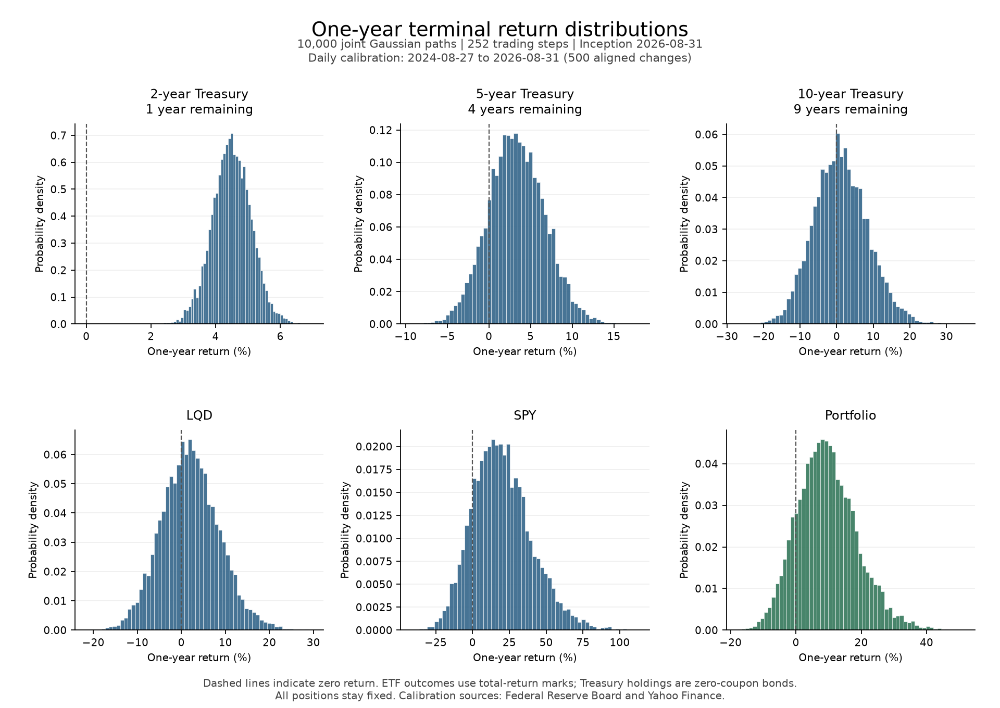
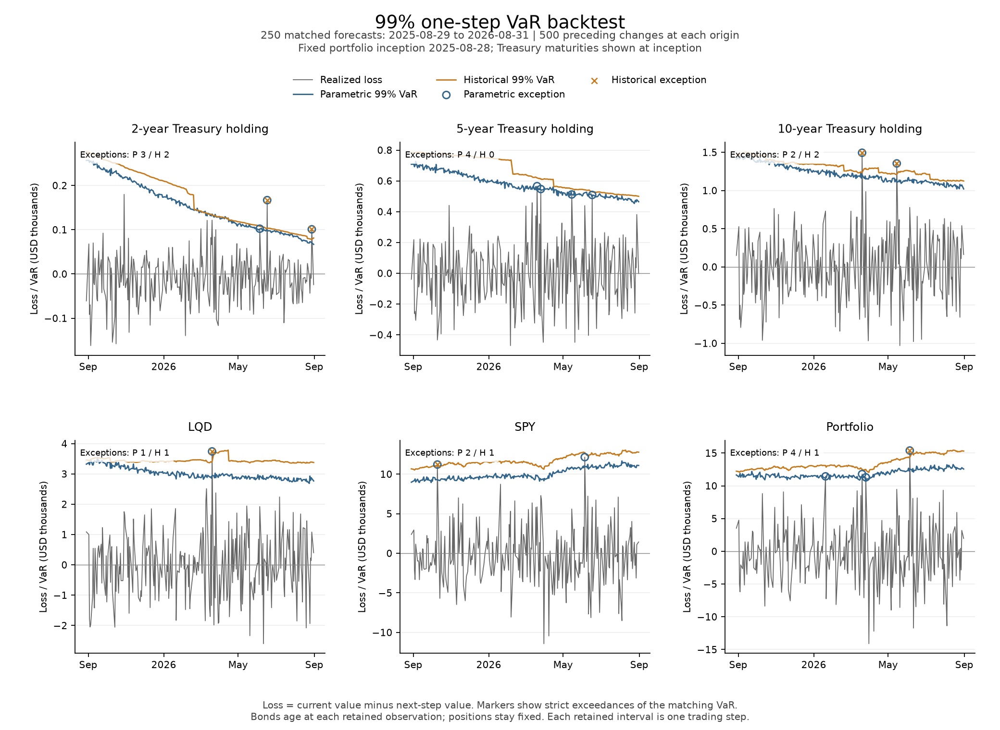

# Multi-Asset Portfolio Simulation and VaR

## Introduction

This project values a fixed USD 1,000,000 portfolio of three hypothetical Treasury zero-coupon bonds, LQD and SPY. It simulates one-year outcomes, backtests 99% one-step Value at Risk (VaR) using Gaussian and historical scenarios, and measures diversification and parametric Euler risk contributions. All holdings share the same joint factor scenarios; portfolio outcomes are sums of those holdings.

## Data and attribution

The analysis period is **2022-09-01 through 2026-08-31**, inclusive. Inputs come from:

| Provider | Inputs and interpretation | Retention and access |
| --- | --- | --- |
| Board of Governors of the Federal Reserve System | Continuously compounded fitted zero yields, in percent: `SVENY01`, `SVENY02`, `SVENY04`, `SVENY05`, `SVENY09`, `SVENY10`. These are estimated curve points, not observed traded zero-coupon prices. | The exact public CSV response, including its preamble and full history, is published as [treasury_yields.csv](data/treasury_yields.csv). Analysis uses only the stated period. |
| Yahoo Finance and its underlying data providers | Daily USD `Close` observations and Yahoo's `Adj Close` series for [LQD](https://finance.yahoo.com/quote/LQD/history/) and [SPY](https://finance.yahoo.com/quote/SPY/history/), retrieved through the independent `yfinance` client. | Both fields are retained locally in `data/etf_prices.csv`; this snapshot is ignored and unpublished. |

Treasury estimates are from the Board's [nominal yield curve dataset](https://www.federalreserve.gov/data/nominal-yield-curve.htm), credited to Gürkaynak, Sack and Wright, *The U.S. Treasury Yield Curve: 1961 to the Present*. Its redistribution follows the Board's [public-domain and attribution policy](https://www.federalreserve.gov/disclaimer.htm). Yahoo's [data policy prohibits redistribution](https://help.yahoo.com/kb/SLN2310.html); [yfinance's documentation](https://ranaroussi.github.io/yfinance/) does not grant a data licence and directs users to Yahoo's terms.

Both snapshots were retrieved on **2026-11-01 UTC**. [retrieval_manifest.json](results/retrieval_manifest.json) records exact retrieval times, queries, SHA-256 hashes, permissions and retained dates. In-period source counts are 1,043 Treasury rows and 1,002 ETF rows. Complete-date alignment retains **995 levels and 994 changes**, dropping 48 dates from the union. No observation is filled and the analysis period is never extended to meet coverage requirements.

## Construction

### Factor construction

Dates are validated, sorted and aligned across all six yields and both ETF price fields **before differencing**. Percentage yields are multiplied by 0.01. The eight factors, in order, are absolute decimal yield changes at **1, 2, 4, 5, 9 and 10 years**, followed by **LQD and SPY log adjusted-close returns**:

$$
x_t=(\Delta y_{1,t},\Delta y_{2,t},\Delta y_{4,t},\Delta y_{5,t},\Delta y_{9,t},\Delta y_{10,t},\log(A_{L,t}/A_{L,t-1}),\log(A_{S,t}/A_{S,t-1})).
$$

Here $y_{u,t}$ is the decimal zero yield at tenor $u$ years; $A_{L,t}$ and $A_{S,t}$ are LQD and SPY adjusted closes. The index $t-1$ denotes the preceding retained date, and $\Delta y_{u,t}=y_{u,t}-y_{u,t-1}$.

### Valuation construction

Each consecutive retained interval counts as one trading step of 1/252 year, including intervals spanning missing market dates. Zero yields are interpolated linearly in remaining maturity between available tenors; extrapolation is prohibited. For face amount $F$, initial maturity $T$ and elapsed steps $k$, the constructed bond value is

$$
\tau=T-k/252,\qquad B_t=F\exp[-y_t(\tau)\tau].
$$

An ETF's constructed total-return mark is $M_t=C_0(A_t/A_0)$, anchored to its inception quoted Close $C_0$ using adjusted closes $A$. Fixed units therefore track the provider's total-return ratios. These marks are distinct from subsequent quoted Close prices. Bond unit prices are USD per USD 1 face; ETF marks are USD per unit.

### Portfolio construction

At each inception, allocations to `UST_2Y`, `UST_5Y`, `UST_10Y`, `LQD` and `SPY` are **10%, 10%, 10%, 30% and 40%**. Fractional face amounts and ETF units equal each allocation divided by its inception unit mark. Quantities then remain fixed. Portfolio value is the sum of position values; simple returns are value divided by inception value minus one. Realized P&L is the next value minus the current value; loss has the opposite sign.

There are two separate USD 1,000,000 inceptions, each with fresh 2-, 5- and 10-year bonds. The forward portfolio starts on **2026-08-31**. The retrospective portfolio starts on **2025-08-28** and stays fixed throughout 250 forecast targets, **2025-08-29 through 2026-08-31**. Bonds age at every aligned step, including within each scenario and realized valuation.

## Statistical and mathematical models

**Joint Gaussian scenarios.** The latest 500 available eight-factor changes estimate a sample mean $\hat\mu$ and covariance $\hat\Sigma$ with denominator 499. For scenario $s$ and trading step $k$, daily shocks satisfy $x_{s,k}\sim N_8(\hat\mu,\hat\Sigma)$, independently across trading steps, preserving contemporaneous cross-factor covariance. Sampling uses NumPy's SVD method without covariance tuning. Forward simulation holds these estimates fixed for 252 steps, adds yield changes and accumulates ETF log returns, then fully reprices all holdings. Terminal bond maturities are **1, 4 and 9 years**.

**Rolling VaR.** At each origin, calibration uses exactly the preceding 500 aligned changes, including the change known at that origin and excluding the next target observation. Parametric VaR uses 10,000 joint Gaussian one-step draws. Historical VaR applies all 500 observed joint shocks without recentering or resampling. Both assume the recent joint factor distribution represents next-step risk and fully reprice the same current holdings after one additional aging step. Standalone and portfolio losses come from the same scenario rows.

For $N$ scenario losses sorted in ascending order by permutation $\pi$, use the linear empirical quantile:

$$
h=(N-1)0.99,\quad a=\lfloor h\rfloor,\quad b=\lceil h\rceil,\quad w=h-a,
$$

$$
\operatorname{VaR}_{0.99}=(1-w)L_{\pi(a)}+wL_{\pi(b)}.
$$

Ranks in these equations start at zero; the Euler CSV records ranks and scenario IDs starting at one. VaR retains its sign. An exception occurs strictly when realized loss exceeds VaR. Latest diversification benefit is summed standalone VaRs minus portfolio VaR; its fraction divides by the standalone sum and is flagged undefined if that denominator is zero.

**Coverage tests.** Kupiec unconditional coverage uses all $n=250$ exception indicators and null probability $p_0=0.01$. With $x$ exceptions,

$$
\ell_B(x,n;p)=x\log p+(n-x)\log(1-p),\qquad
LR_{\rm UC}=2[\ell_B(x,n;x/n)-\ell_B(x,n;p_0)].
$$

Zero-count likelihood terms use $0\log0=0$. Christoffersen independence and conditional coverage condition on the first indicator, leaving 249 transitions. Let $\ell_M$, $\ell_I$ and $\ell_0$ be the transition log likelihoods for a fitted two-state Markov model, a fitted common IID probability, and the fixed 1% probability. Then $LR_{\rm IND}=2(\ell_M-\ell_I)$ and $LR_{\rm CC}=2(\ell_M-\ell_0)$. Their asymptotic chi-square degrees of freedom are 1 and 2; Kupiec uses 1. Decisions reject at $p<0.05$. An unobserved outgoing conditioning state makes the Markov tests unidentifiable and explicitly undefined. This conditioning convention follows [Christoffersen's coverage framework](https://users.ssc.wisc.edu/~behansen/718/Christoffersen1998.pdf): conditional coverage combines independence with unconditional coverage on the **transition targets**, rather than the separate 250-indicator Kupiec statistic.

**Euler attribution.** If $L_{s,i}$ is position $i$'s loss in joint scenario $s$ and $q_i$ its quantity, the latest parametric contribution is

$$
C_i=q_i\frac{\partial\operatorname{VaR}}{\partial q_i}
=(1-w)L_{\pi(a),i}+wL_{\pi(b),i},\qquad \sum_i C_i=\operatorname{VaR}.
$$

The portfolio quantile's same ordered scenarios and interpolation weights determine every contribution. Contributions remain signed. Stable sorting makes ties deterministic; attribution at a quantile kink depends on that ordering convention.

## Configurations

[config.py](portfolio_var/config.py) is authoritative. [frozen_config.json](artifacts/frozen_config.json) is a generated record of effective settings, environment versions and the complete named seed plan; it is not read as configuration.

| Setting | Value |
| --- | --- |
| Input period | 2022-09-01 to 2026-08-31, inclusive |
| Calibration / minimum aligned coverage | 500 changes per window / 751 levels and 750 changes |
| Forward simulation | 10,000 paths × 252 steps × 8 factors |
| Rolling backtest | 250 matched targets; 10,000 parametric or 500 historical scenarios per origin |
| VaR / test significance | 99% / 5% |
| Trading clock | 252 retained steps per year |
| Master seed / generator | 42 / PCG64; SeedSequence pool size 4 |

Named `SeedSequence.spawn` branches are fixed as `forward_simulation: [0]` and `parametric_var: [1]`. Every calendar target date in the input period receives `[1, d]`, where `d` is its zero-based calendar-day offset from 2022-09-01. All **1,461** assignments, including unused dates, are fixed before execution. Stage order, forecast subset and iteration order do not change a date's random stream.

## Results

The saved one-year simulation starts on **2026-08-31**, calibrated to 500 changes dated **2024-08-27 through 2026-08-31**. These are modeled outcomes, not realized investment returns. Percentile ranges describe the 10,000 simulated simple returns.

| Holding | Mean terminal value (USD) | Mean return (%) | 5th–95th return percentiles (%) |
| --- | ---: | ---: | ---: |
| UST_2Y | 104,493.78 | 4.49 | 3.51 to 5.47 |
| UST_5Y | 103,320.21 | 3.32 | −2.19 to 8.99 |
| UST_10Y | 101,103.12 | 1.10 | −10.61 to 13.58 |
| LQD | 306,019.92 | 2.01 | −8.47 to 12.95 |
| SPY | 480,162.14 | 20.04 | −9.94 to 55.79 |
| Portfolio | 1,095,099.17 | 9.51 | −4.46 to 25.63 |



The retrospective backtest has **250 matched forecasts for every holding and the portfolio under each method**, with targets from 2025-08-29 to 2026-08-31. Exception counts and rates are:

| Holding | Parametric exceptions | Historical exceptions |
| --- | ---: | ---: |
| UST_2Y | 3 (1.2%) | 2 (0.8%) |
| UST_5Y | 4 (1.6%) | 0 (0.0%) |
| UST_10Y | 2 (0.8%) | 2 (0.8%) |
| LQD | 1 (0.4%) | 1 (0.4%) |
| SPY | 2 (0.8%) | 1 (0.4%) |
| Portfolio | 4 (1.6%) | 1 (0.4%) |

Of 36 coverage tests, 34 are defined. The historical UST_5Y Kupiec test rejects 99% unconditional coverage with zero exceptions (**LR 5.0252, p 0.0250**). Its independence and conditional-coverage tests are undefined because the exception state has no outgoing transitions. The other 33 defined tests do not reject at 5%; non-rejection alone does not establish model adequacy.



Latest diversification compares the matched forecast from **2026-08-28 to 2026-08-31**, using the aged retrospective holdings:

| Method | Portfolio VaR (USD) | Sum of standalone VaRs (USD) | Benefit (USD) | Benefit / standalone sum |
| --- | ---: | ---: | ---: | ---: |
| Parametric | 12,560.52 | 15,417.46 | 2,856.94 | 18.53% |
| Historical | 15,302.55 | 17,855.17 | 2,552.61 | 14.30% |

Latest parametric Euler contributions reconcile to that same USD 12,560.52 portfolio VaR. SPY contributes 83.99% of the total.

| Holding | Contribution (USD) | Share (%) |
| --- | ---: | ---: |
| UST_2Y | 2.23 | 0.02 |
| UST_5Y | 104.56 | 0.83 |
| UST_10Y | 362.62 | 2.89 |
| LQD | 1,541.55 | 12.27 |
| SPY | 10,549.56 | 83.99 |
| Total | 12,560.52 | 100.00 |

The stored full-precision reconciliation residual is **USD 0**. Displayed contributions are rounded individually.

## Setup and reproduction

The tested environment is **CPython 3.14.7 on Windows AMD64**. Direct library versions are pandas 3.1.0, NumPy 2.5.4, SciPy 1.18.1, requests 2.34.2, yfinance 1.7.0 and Matplotlib 3.11.2. [requirements.txt](requirements.txt) pins these and their transitive dependencies exactly.

With Python 3.14.7 selected, run from the project root in PowerShell:

```powershell
python -m venv --without-scm-ignore-files .venv
.\.venv\Scripts\Activate.ps1
python -m pip install -r requirements.txt
python -m pip check
python -m unittest discover -s tests -p test_project.py
python run_pipeline.py
```

Activation is optional: use `.\.venv\Scripts\python.exe` in place of `python` for the installation, checks and pipeline commands. The **55 passing unit tests** cover preparation and provenance, independent valuation, calibration timing, joint scenarios, seed ordering, quantiles, coverage edge cases and Euler reconciliation. Tests use temporary synthetic fixtures and require neither network access nor the private ETF snapshot.

The pipeline prepares inputs, initializes both portfolios, simulates terminal outcomes, backtests both VaR methods and overwrites the generated tables, figures and frozen configuration. No project API key or environment variable is required. On an ordinary rerun, existing snapshots are reused without source requests; query or hash mismatches fail explicitly. A fresh public checkout includes the Treasury snapshot and retrieves the missing ETF snapshot independently, subject to Yahoo's applicable terms and endpoint availability. Access can be rate-limited or withdrawn. The local ETF CSV retains `Date,LQD_Close,LQD_Adj Close,SPY_Close,SPY_Adj Close`, with prices serialized to 17 significant digits.

Exact reproduction of the recorded numerical run requires lawful local access to the **same ETF snapshot bytes**, the retained Treasury snapshot, unchanged configuration and the tested pinned environment. Fresh downloads may contain revised adjusted prices or yields, so the public checkout alone cannot guarantee the original input vintage. Compare snapshot hashes and queries in the manifest and settings and complete seed assignments in the frozen record. For an intentional new vintage, archive the chosen local snapshot, remove that file and rerun; the corresponding provenance is regenerated. Inadequate aligned coverage stops the run.

With retained inputs on the tested stack, the five numerical CSVs, both PNGs and frozen configuration reproduced byte-for-byte across fresh-process pipeline runs. The manifest's run timestamp updates intentionally. Different Python, numerical libraries, platforms or linear algebra implementations can change Gaussian sample paths; exact cross-platform reproduction is not promised. Git line-ending conversion can also change text-file bytes without changing numerical values; the raw Treasury snapshot is protected by `.gitattributes`.

## Repository and outputs

This is the sole public explanation and reproduction guide. The inventory below links every published file. Private ETF inputs, local environments, caches and credentials remain ignored.

| Location | Contents |
| --- | --- |
| [README.md](README.md) | Project explanation, findings and reproduction guide. |
| [.gitignore](.gitignore) | Private-input, environment, credential, cache and packaging exclusions; permitted snapshot exception. |
| [.gitattributes](.gitattributes) | Preserves the Treasury snapshot's exact bytes. |
| [requirements.txt](requirements.txt) | Exact direct and transitive dependency pins. |
| [run_pipeline.py](run_pipeline.py) | Thin entry point for all stages and reports. |
| [portfolio_var/__init__.py](portfolio_var/__init__.py) | Package initialization. |
| [portfolio_var/config.py](portfolio_var/config.py) | Authoritative paths, settings and named seed assignments. |
| [portfolio_var/data.py](portfolio_var/data.py) | Source retrieval, retained snapshots, alignment, factors and provenance. |
| [portfolio_var/pricing.py](portfolio_var/pricing.py) | Yield interpolation, bond aging, ETF marks and fixed holdings. |
| [portfolio_var/simulation.py](portfolio_var/simulation.py) | Joint Gaussian forward simulation and terminal repricing. |
| [portfolio_var/risk.py](portfolio_var/risk.py) | Rolling VaR, losses, coverage tests, diversification and Euler attribution. |
| [portfolio_var/reporting.py](portfolio_var/reporting.py) | Tables, figures and frozen configuration generation. |
| [tests/test_project.py](tests/test_project.py) | Consolidated correctness and reproducibility tests. |
| [data/treasury_yields.csv](data/treasury_yields.csv) | Permitted full Federal Reserve response retained without alteration. |
| [artifacts/frozen_config.json](artifacts/frozen_config.json) | Effective settings, environment versions and all named child-seed assignments. |
| [results/retrieval_manifest.json](results/retrieval_manifest.json) | Source queries, retrieval times, hashes, permissions and alignment audit. |
| [results/terminal_outcomes.csv](results/terminal_outcomes.csv) | 10,000 paths of terminal unit marks, position values and returns, and portfolio values and returns. |
| [results/backtest.csv](results/backtest.csv) | 3,000 dated method/holding forecasts, realized P&L and losses, VaR and exceptions. |
| [results/coverage_tests.csv](results/coverage_tests.csv) | 36 test records with exception rates, likelihood statistics, p-values, decisions and undefined flags. |
| [results/diversification.csv](results/diversification.csv) | Latest portfolio and summed standalone VaRs for both methods. |
| [results/euler_contributions.csv](results/euler_contributions.csv) | Five signed latest parametric contributions, quantile scenario indices and weights, and reconciliation. |
| [results/figures/terminal_distributions.png](results/figures/terminal_distributions.png) | One-year simulated return distributions for five assets and the portfolio. |
| [results/figures/var_backtest.png](results/figures/var_backtest.png) | Realized losses and both VaR methods with dated exceptions. |

## Assumptions and limitations

- Gaussian IID shocks and a fixed 500-change calibration omit volatility dynamics, jumps and heavy-tailed innovations. One-year outcomes repeat the estimated daily drift and covariance for all 252 steps; the modeled mean return is sensitive to that window.
- Treasury holdings are hypothetical zero-coupon positions valued from fitted yields with linear interpolation. The trading clock treats every retained interval equally even when calendar gaps differ. ETF marks inherit Yahoo's adjustment convention.
- The backtest uses the 2026-11-01 retrieval vintage. Revised yields and adjusted prices can differ from the values available at the historical forecast origins.
- Holdings allow fractional quantities and remain fixed. There are no transaction costs, taxes, funding costs, liquidity constraints or separate default events; adjusted-close ratios represent reinvestment within the constructed ETF marks.
- A 250-forecast sample contains little information about a 1% tail. Coverage p-values use asymptotic approximations; both the reported rejection and undefined tests matter when interpreting results.
- Finite scenario counts introduce quantile and Euler allocation uncertainty. Contributions are local to the selected portfolio loss ordering; these results do not establish future coverage or a universal diversification benefit.
